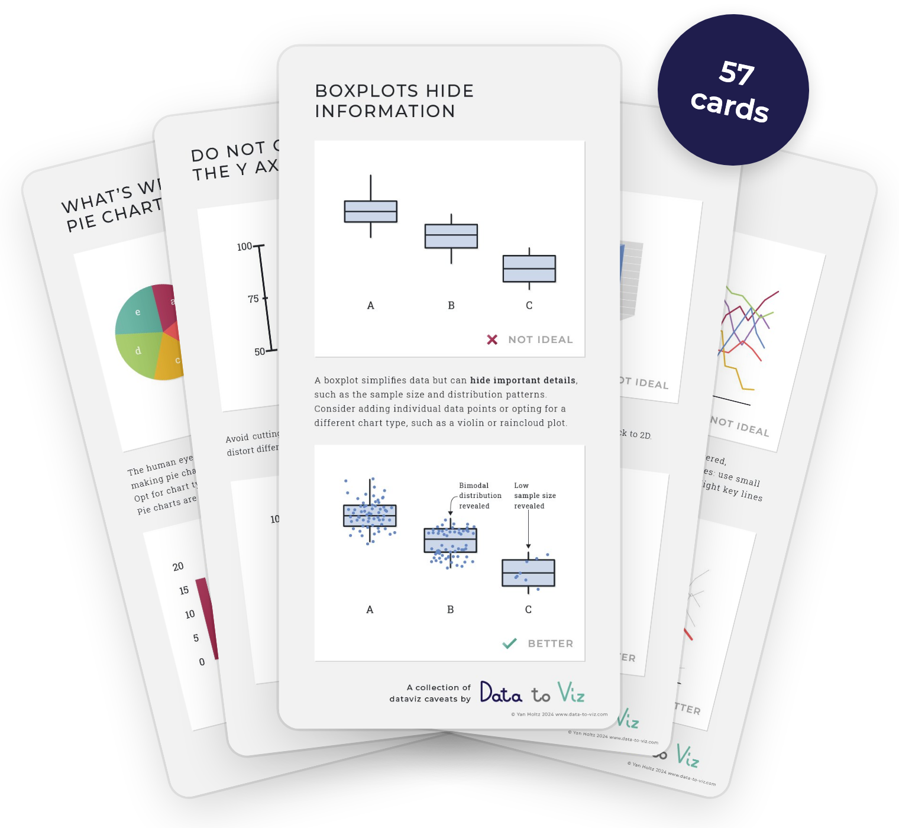

# Stop falling into the most common dataviz caveats

## What is this?

A collection of flashcards about the most common data visualization caveats, by [Data to Viz](https://www.data-to-viz.com).
Each card shows a "not ideal" chart next to a better alternative, with a short explanation. They cover misleading charts, wrong chart types, color, design, maps, labels and legends, and dashboards.

Every card comes in a horizontal (2560×1600) and a vertical (720×1440) version, as PNG in [`png/`](png) and as lossless WebP in [`webp/`](webp). New cards can be generated with the scripts in [`tools/`](tools).

## A better way to browse the flashcards

👉 Browse all the cards at [dataviz-inspiration.com/caveats](https://www.dataviz-inspiration.com/caveats), for a much better experience than this repo.

## For AI agents

🤖 [`caveats.md`](caveats.md) describes every card in plain text, so an agent can work with the collection without looking at the images. Point your AI assistant or coding agent to it (or paste it in) and ask it to review a chart or a piece of plotting code against all the caveats: for each one it gets what to look for, why it matters, how to fix it and when it's fine.

The text of every card lives in [`caveats.json`](caveats.json). `caveats.md` is generated from it by `node tools/docs.mjs`.

## License

The cards are free to use for non-commercial purposes, as long as you credit [Data to Viz](https://www.data-to-viz.com) with a link to it. They are released under [CC BY-NC 4.0](https://creativecommons.org/licenses/by-nc/4.0/): see [`LICENSE`](LICENSE). For commercial use, please get in touch.
